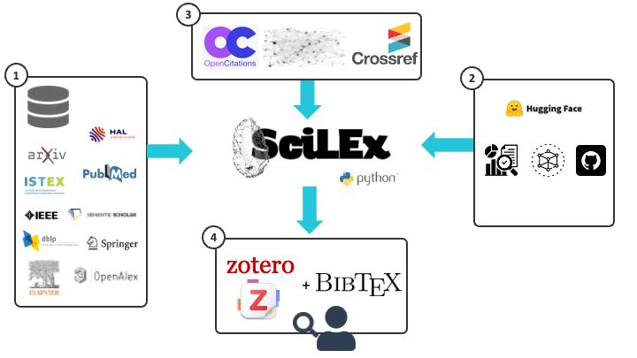

<div align="center">
<br>


</div>

<p align="center">
    <em>Systematic literature search across 14 academic APIs</em>
</p>

<p align="center">
    
    
    
    
</p>

<p align="center">
    <a href="https://scilex.readthedocs.io/en/latest/">
    
    </a>
    
    <a href="https://joss.theoj.org/papers/9fc1db5f4db530c036dd7744e2147b2d"></a>
</p>

---
> SciLEx — like the silex stone that early humans relied on to spark fire from raw material — is a lightweight, portable tool designed to ignite research exploration. Rather than navigating fragmented databases, confronting redundant results, and manually sifting through noise, SciLEx strikes directly at the core challenge: it queries heterogeneous digital library APIs, applies smart deduplication and quality filtering, and delivers a clean, curated corpus ready for export to Zotero or BibTeX. It is not a full-scale review platform — it is the essential flint in the researcher's toolkit, engineered to quick-start systematic literature reviews with precision and minimal friction.


## Table of Contents

- [Overview](#overview)
- [Architecture](#architecture)
- [Key Features](#key-features)
- [Project Structure](#project-structure)
- [Getting Started](#getting-started)
- [Citation](#citation)
- [Contributing](#contributing)
- [License](#license)

---

## Overview

**SciLEx** (Science Literature Exploration) is a Python toolkit for systematic literature reviews. It crawls 14 academic APIs in parallel, deduplicates results using DOI-based and normalized title exact matching, and applies a 5-phase quality filtering pipeline before exporting to Zotero, BibTeX or RDF/Turtle.
It runs from the command line or from a desktop app (macOS, Windows, Linux) that works on the same review folders.


---

## Architecture



---

## Key Features

- Multi-API collection with parallel processing (14 academic APIs)
- Smart deduplication using DOI and normalized title matching
- 5-phase quality filtering pipeline with time-aware citation thresholds:
  1. **ItemType Filter** — whitelist by publication type (journal, conference, etc.)
  2. **Quality Filter** — require DOI, abstract, year, minimum author count, optional open-access
  3. **Abstract Quality Filter** — remove placeholder or low-quality abstracts
  4. **Citation Filter** — time-aware thresholds (e.g. ≥1 citation after 18 months, ≥10 after 3 years)
  5. **Relevance Ranking** — composite score (0–10) from keyword density, metadata completeness, venue type, and citation impact
- Citation count enrichment via CrossRef, OpenCitations, OpenAlex and Semantic Scholar
- Optional CORE/SJR venue ranking, open-access lookup (Unpaywall) and LLM relevance screening (OpenRouter)
- HuggingFace enrichment: query HuggingFace Hub to retrieve associated ML models, datasets, and GitHub repositories
- Analyses: co-authorship graphs and communities, snowball sampling, seed papers, cluster summaries, keyword suggestions
- Export to Zotero (bulk upload), BibTeX (with PDF links) or RDF/Turtle
- Desktop app: configure, collect, screen, export and analyse a review without the command line
- Idempotent, resumable collections (`--resume`, incremental `--since`)

### Supported APIs

| API | Key Required | Coverage | Best For |
|-----|-------------|----------|----------|
| **SemanticScholar** | Optional | 200M+ papers | CS/AI papers, citation networks |
| **OpenAlex** | Optional | 250M+ works | Broad coverage, ORCID data |
| **IEEE** | Yes | 5M+ docs | Engineering, CS conferences |
| **Arxiv** | No | 2M+ preprints | Preprints, physics, CS |
| **BioRxiv** | No | ~50k preprints/year | Biology preprints (bioRxiv only; no server-side search, so a yearly cache is filtered client-side) |
| **Springer** | Yes | 13M+ docs | Journals, books |
| **Elsevier** | Yes | 18M+ articles | Medical, life sciences |
| **PubMed** | Optional | 35M+ papers | Biomedical literature |
| **PubMedCentral** | Optional | 10M+ full texts | Open-access biomedical full text |
| **HAL** | No | 1M+ docs | French research, theses |
| **DBLP** | No | 6M+ CS papers | CS bibliography, 95%+ DOI |
| **Istex** | No | 25M+ docs | French institutional access |
| **OpenAIRE** | No | 200M+ docs | Open-access, EU research |
| **ORKG** | No | 55K papers | Structured CS research comparisons |

See the [API Comparison](https://scilex.readthedocs.io/en/latest/reference/api-comparison.html) for rate limits, coverage details, and limitations.

---

## Project Structure

```sh
└── SciLEx/
    ├── README.md
    ├── pyproject.toml
    ├── CONTRIBUTING.md
    ├── scilex.yml.example
    ├── keys.yml.example
    ├── scilex/
    │   ├── run_collection.py, aggregate_collect.py, collect_status.py   # CLI entry points
    │   ├── enrich_with_hf.py, push_to_zotero.py, export_to_*.py          # enrichment and outputs
    │   ├── settings/        # scilex.yml / keys.yml schema, presets, loader, migration
    │   ├── templates/       # scilex init templates
    │   ├── pipeline/        # aggregation, filtering, ranking, reports
    │   ├── crawlers/        # one collector per API
    │   ├── citations/       # 4-tier citation resolution
    │   ├── rdf/             # RDF/Turtle export
    │   ├── graph_analysis/, snowball/, summarize/, keyword_suggestions/
    │   ├── gui/             # desktop app (scilex-gui)
    │   ├── webapi/          # FastAPI + Streamlit web interface
    │   ├── Zotero/
    │   └── HuggingFace/
    ├── tests/
    ├── docs/
    └── img/
```

---

## Getting Started

### Prerequisites

- 
- [uv](https://docs.astral.sh/uv/) (recommended) or pip

### Installation

1. Clone the repository:

```sh
❯ git clone https://github.com/Wimmics/SciLEx
```

2. Navigate to the project directory:

```sh
❯ cd SciLEx
```

3. Install dependencies:

**Using `uv`** &nbsp; []

```sh
❯ uv sync
```

**Using `pip`:**

```sh
❯ pip install -e .

# With dev dependencies (pytest, ruff, coverage)
❯ pip install -e ".[dev]"
```

The desktop app needs the `gui` extra: `uv sync --extra gui` (or `pip install -e ".[gui]"`).

### Configuration

SciLEx uses two files:

- `scilex.yml`: one per review, in your working folder (search terms, years, APIs, filters).
- `keys.yml`: your API keys, shared by all reviews, in `~/.config/scilex/keys.yml`.

```sh
❯ mkdir my-review && cd my-review
❯ scilex init                                   # writes ./scilex.yml (or: scilex-init --template computer-science)
❯ mkdir -p ~/.config/scilex
❯ cp /path/to/SciLEx/keys.yml.example ~/.config/scilex/keys.yml   # then add your keys
❯ scilex config check                           # validate both files without running anything
```

`scilex.yml.example` lists every option with its default; you only write what differs from the defaults.
Typos are reported with a suggestion (`filters.max_paper: unknown key. Did you mean ranking.max_papers?`).
Use `scilex config show` to see the effective values and where each one comes from.

See the [Configuration Reference](https://scilex.readthedocs.io/en/latest/reference/configuration.html) for all settings.

#### Migrating from the old format

Older versions used `scilex/scilex.config.yml`, `scilex/scilex.advanced.yml` and `scilex/api.config.yml`.
They are still read (with a warning) but are deprecated. Convert them with:

```sh
❯ scilex config migrate                  # print the equivalent scilex.yml
❯ scilex config migrate --write          # write ./scilex.yml (add --force to overwrite)
❯ scilex config migrate --from DIR       # read the old files from DIR instead of the package
```

Move your API keys from `scilex/api.config.yml` to `~/.config/scilex/keys.yml` (same structure).

### Usage

**Option A — with environment activation:**
```sh
❯ source .venv/bin/activate       # macOS/Linux
❯ .venv\Scripts\activate          # Windows
❯ scilex-collect          # run from the folder that contains scilex.yml
```

**Option B — with `uv run` (no activation needed):**
```sh
❯ uv run scilex-collect
```

Run the pipeline step by step:

```sh
# 0. Validate the configuration
❯ scilex config check

# 1. Collect papers from all configured APIs
❯ scilex-collect                # --resume NAME to continue a run, --since YYYY-MM-DD for incremental
❯ python -m scilex status       # collection completeness (keywords, APIs, years)

# 2. Deduplicate, filter and rank
❯ scilex-aggregate              # --skip-citations to skip citation lookups, --workers N
❯ scilex-aggregate --collection NAME --use-current-config   # replay on an existing (even partial) collection with the current scilex.yml

# 3. (Optional) Enrich with HuggingFace metadata
❯ scilex-enrich

# 4. Export results
❯ scilex-push-zotero        # Push to a Zotero collection
❯ scilex-export-bibtex      # Export to BibTeX
❯ scilex-export-turtle      # Export to RDF/Turtle
```

Every pipeline command accepts `--config PATH` and `--keys PATH`.
`python -m scilex <collect|aggregate|status|enrich|export-bibtex|push-zotero|init|config>` is the equivalent module entry point.

Other commands:

```sh
❯ scilex-enrich-citations   # add citation counts to an existing aggregated file
❯ scilex-report             # charts / report from aggregated results
❯ scilex-analyze            # graph analysis (co-authorship, communities)
❯ scilex-snowball           # snowball sampling (references / citing papers)
❯ scilex-seed               # start from seed papers (DOIs, BibTeX)
❯ scilex-summarize          # cluster summaries
❯ scilex-suggest-keywords   # keyword suggestions from a first collection
```

See the [Quick Start Guide](https://scilex.readthedocs.io/en/latest/getting-started/quick-start.html) for a complete walkthrough.

**Option C — 🖥️ Desktop app**

Ready-to-run builds for macOS (`.dmg`), Windows (`.zip`) and Linux (`.tar.gz`) are published as artifacts of the
[GUI build workflow](https://github.com/Wimmics/SciLEx/actions/workflows/gui-build.yml) (the macOS app is not signed yet:
right-click → **Open** the first time). A review goes through ① Configure, ② Collect, ③ Screen, ④ Export and ⑤ Analyses;
API keys are set once for all reviews.

From a checkout:
```sh
❯ uv sync --extra gui
❯ uv run scilex-gui              # native window
❯ uv run scilex-gui --browser    # same UI in a browser tab (--port N, --no-open)
❯ uv run scilex-gui --self-test  # check the installation without opening a window
❯ scripts/build_gui.sh           # build a standalone app with PyInstaller (dist/), then self-test it
```
See the [desktop app guide](docs/user-guides/gui.md).

**Option D - 💻 Web Interface [BETA VERSION]**
* [Youtube Tutorial](https://www.youtube.com/watch?v=FXZtrlOJ-vU)
* [Complete Documentation](https://scilex.readthedocs.io/en/latest/user-guides/WebInterfaceGuide.html)

### Testing

Install dev dependencies first (not included in the default install):

```sh
❯ uv sync --extra dev
```

Then run the tests:

```sh
❯ uv run python -m pytest tests/ -v                                              # All tests
❯ uv run python -m pytest tests/ --cov=scilex --cov-report=term-missing         # With coverage
❯ uv run python -m pytest tests/ -v -m "not live"                               # Offline tests only
```

---


## Citation

If you use SciLEx in your research, please cite:

**Full text:**

Célian Ringwald, Benjamin Navet, Yousouf Taghzouti, Fabien Gandon. SciLEx, Science Literature Exploration Toolkit ⟨swh:1:dir:944639eb0260a034a5cbf8766d5ee9b74ca85330⟩.

**BibTeX:**

```bibtex
@softwareversion{scilex2026,
  TITLE = {{SciLEx, Science Literature Exploration Toolkit}},
  AUTHOR = {Ringwald, Célian and Navet, Benjamin and Taghzouti, Yousouf and Gandon, Fabien},
  URL = {https://github.com/Wimmics/SciLEx},
  NOTE = {},
  INSTITUTION = {{University Côte d'Azur ; CNRS ; Inria}},
  YEAR = {2026},
  MONTH = Fev,
  SWHID = {swh:1:dir:944639eb0260a034a5cbf8766d5ee9b74ca85330},
  VERSION = {1.0},
  REPOSITORY = {https://github.com/Wimmics/SciLEx},
  LICENSE = {MIT Licence},
  KEYWORDS = {Python, Scientific literature, literature research, paper retrieval},
  HAL_ID = {},
  HAL_VERSION = {},
}
```

---

## Contributing

- Report issues: [GitHub Issues](https://github.com/Wimmics/SciLEx/issues)
- See [CONTRIBUTING.md](CONTRIBUTING.md) for development guidelines

<p align="center">
   <a href="https://github.com/Wimmics/SciLEx/graphs/contributors">
      
   </a>
</p>

---

## License

This project is protected under the [MIT](LICENSE) License. For more details, refer to the [LICENSE](LICENSE) file.

---

<p align="center">
   <a href="#top">Return to top</a>
</p>
